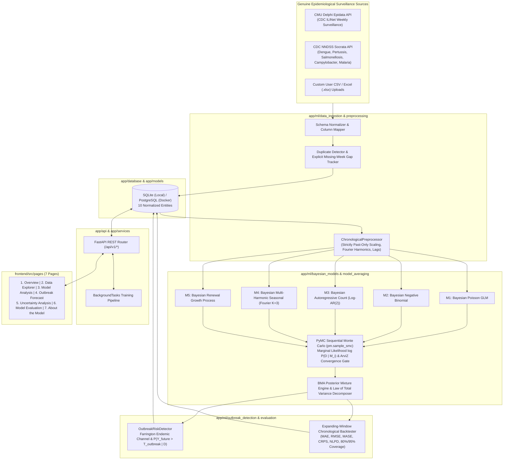

# System Architecture: Disease Outbreak Prediction System Using Bayesian Model Averaging

## 1. Architectural Overview

The system is architected as a modular, reproducible epidemiological intelligence platform separating data ingestion, leakage-safe chronological preprocessing, Bayesian probabilistic inference (`PyMC v6` + `ArviZ v1.3`), database persistence (`SQLAlchemy 2.x`), asynchronous/background REST orchestration (`FastAPI`), and interactive visualization (`React` + `TypeScript` + `Tailwind CSS` + `Recharts`).



---

## 2. Backend Directory Structure

```text
backend/
├── app/
│   ├── main.py                         # FastAPI application entrypoint & lifespan seeding
│   ├── api/
│   │   └── routes.py                   # REST API endpoints (/datasets, /eda, /models, /forecasts, /uncertainty, /evaluation, /overview)
│   ├── core/
│   │   └── config.py                   # Environment settings & Bayesian SMC configuration defaults
│   ├── database/
│   │   └── session.py                  # SQLAlchemy engine & session management
│   ├── models/
│   │   └── entities.py                 # 10 normalized ORM models (Disease, Location, Dataset, DiseaseObservation, TrainingRun, etc.)
│   ├── schemas/
│   │   └── api_schemas.py              # Pydantic v2 request/response validation schemas
│   ├── services/
│   │   └── pipeline_service.py         # End-to-end training, BMA synthesis, risk detection & validation orchestrator
│   └── ml/
│       ├── data_ingestion/
│       │   └── ingestor.py             # CSV/Excel/API ingestion, schema mapping, duplicate & missing-gap tracking
│       ├── preprocessing/
│       │   └── preprocessor.py         # Leakage-safe chronological splitting & temporal feature construction
│       ├── exploratory_analysis/
│       │   └── eda.py                  # Comprehensive EDA, seasonal decomposition, VMR dispersion & anomaly detection
│       ├── bayesian_models/
│       │   └── candidate_models.py     # PyMC v6 SMC models M1..M5, ArviZ diagnostics & recursive trajectory rollout
│       ├── model_averaging/
│       │   └── bma_engine.py           # Log-sum-exp posterior model probabilities, convergence gate & mixture sampling
│       ├── outbreak_detection/
│       │   └── detector.py             # Seasonal endemic channel thresholds & exceedance probability classification
│       └── evaluation/
│           └── backtester.py           # Expanding-window chronological cross-validation (CRPS, NLPD, MASE, RMSE, MAE)
├── data/
│   ├── cdc_ilinet_weekly_2017_2024.csv # Genuine CDC ILINet weekly surveillance dataset (2,502 rows)
│   ├── cdc_nndss_weekly_2022_2024.csv  # Genuine CDC NNDSS weekly surveillance dataset (7,020 rows)
│   └── bma_outbreak_system.db          # Persistent SQLite database with pre-seeded runs and backtests
├── scripts/
│   ├── fetch_real_datasets.py          # Live API downloader for CMU Delphi & CDC Socrata
│   └── seed_initial_runs.py            # Reproducible database seeding & initial BMA training script
└── tests/
    ├── test_phase2_pipeline.py         # Data ingestion, Excel/CSV, missing gap & EDA tests
    ├── test_phase3_4_models_and_bma.py # Candidate Bayesian models & BMA mathematical verification tests
    ├── test_phase5_outbreak_and_eval.py# Outbreak exceedance, CRPS/NLPD & zero-leakage backtest tests
    └── test_phase6_api_integration.py  # End-to-end FastAPI integration tests
```

---

## 3. Normalized Database Schema

The persistence layer uses 10 normalized relational tables defined in [entities.py](file:///c:/Users/lokes/Downloads/ML%20presentation/backend/app/models/entities.py):

1. `diseases`: Stores pathogen/syndrome metadata (`code`, `name`, `default_seasonality_period`, `transmission_mode`).
2. `locations`: Stores jurisdictional metadata (`code`, `name`, `region_type`, `country`, `population`).
3. `datasets`: Tracks dataset provenance (`name`, `source_name`, `source_url`, `attribution`, `downloaded_at`, `file_hash` SHA-256, `row_count`, `missing_count`, `duplicate_count`).
4. `disease_observations`: Stores normalized chronological records with a composite uniqueness constraint on `(dataset_id, disease_id, location_id, observation_date)` and explicit boolean flags `is_missing` and `is_imputed`.
5. `training_runs`: Stores experiment configuration (`train_start_date`, `train_end_date`, `forecast_horizon`, `random_seed`, `sampling_config_json`, `status`, `progress_pct`).
6. `candidate_model_results`: Stores per-model SMC evidence (`log_marginal_likelihood`, `log_ml_std_error`, `laplace_log_evidence`, `waic`, `loo`), `prior_prob`, `posterior_prob` (BMA weight), convergence flag, and posterior parameter summaries.
7. `model_diagnostics`: 1-to-1 diagnostic record storing `max_rhat`, `min_ess_bulk`, `min_ess_tail`, `divergences`, `sampling_time_sec`, and chain-level SMC log marginal likelihoods.
8. `forecast_records`: Stores horizon-by-horizon predictions (`mean_pred`, `median_pred`, `q025`, `q10`, `q25`, `q75`, `q90`, `q975`) and 3-way decomposed variances (`param_variance`, `obs_variance`, `model_variance`, `total_variance`) for both `BMA` and individual models `M1..M5`.
9. `outbreak_assessments`: Stores `seasonal_baseline_mean`, `seasonal_baseline_std`, `threshold_value`, `threshold_method`, `exceedance_prob`, `expected_growth_rate`, `risk_level`, and `explanation_text`.
10. `validation_runs` & `validation_metric_records`: Stores expanding-window chronological cross-validation fold predictions and out-of-sample metrics (`mae`, `rmse`, `mase`, `crps`, `nlpd`, `coverage_80`, `coverage_95`, `interval_width_80`, `interval_width_95`).

