# PROJECT MASTER DOSSIER: DISEASE OUTBREAK PREDICTION SYSTEM USING BAYESIAN MODEL AVERAGING (BMA)

---

## 1. Project Metadata & Research Team

- **Project Title**: Disease Outbreak Prediction System Using Bayesian Model Averaging (BMA)
- **Domain**: Epidemiological Time-Series Forecasting, Probabilistic Machine Learning & Public Health Surveillance Intelligence
- **Core Probabilistic Engine**: PyMC v6.4 Sequential Monte Carlo (`pm.sample_smc`) + ArviZ v1.3 + Statsmodels v0.15
- **Full-Stack Architecture**: FastAPI + SQLAlchemy 2.1 + SQLite/PostgreSQL + React 18 + TypeScript + Tailwind CSS + Recharts

### Project Team Members

| S.No | Team Member Name | Registration Number | Role & Contributions |
| :---: | :--- | :---: | :--- |
| **1** | **Krishita Satish Kumar** | `RA2411003010405` | Bayesian Statistical Modeling, PyMC Sequential Monte Carlo (SMC) Marginal Likelihood Estimation & ArviZ Convergence Diagnostics |
| **2** | **Harish Neralla** | `RA2411003010398` | Bayesian Model Averaging (BMA) Posterior Mixture Engine, Law of Total Variance Uncertainty Decomposition & Mathematical Verification |
| **3** | **Lokesh R** | `RA2411003010405` | Epidemiological Data Pipeline, Leakage-Safe Chronological Preprocessing, Expanding-Window Backtesting & FastAPI Backend Architecture |
| **4** | **Archisha R** | `RA2411003010419` | Outbreak Exceedance Risk Classification, Exploratory Data Analysis (EDA) & Interactive 7-Page Public Health Intelligence Dashboard |

---

## 2. Executive Summary & Problem Statement

Public health agencies require reliable, uncertainty-aware infectious disease forecasts to anticipate surges in clinical caseloads, identify emerging outbreaks early, and allocate medical countermeasures. However, conditioning forecasts on a **single statistical model** introduces severe structural vulnerability:

1. **Equidispersion Failure**: A standard Poisson Generalized Linear Model assumes $\text{Var}(Y_t) = \mathbb{E}[Y_t]$. Because real epidemiological count data exhibit strong overdispersion ($\text{Variance-to-Mean Ratio} \gg 1$) due to superspreading and reporting batching, Poisson models produce artificially narrow prediction intervals that fail to cover actual outbreak peaks ($0\%$ empirical coverage on U.S. National ILI).
2. **Regime Sensitivity**: Purely seasonal harmonic models capture recurring annual winter peaks well but fail to adapt to sudden week-over-week transmission momentum, whereas purely autoregressive models react rapidly to short-term shocks but risk over-extrapolating transient reporting spikes.

### How Bayesian Model Averaging (BMA) Solves This
Instead of selecting a single winner-take-all model, our system trains **five statistically distinct Bayesian count models** ($M_1 \dots M_5$), estimates each model's exact **marginal likelihood (model evidence)** $P(D \mid M_i)$ via **Sequential Monte Carlo (SMC) tempering**, and combines their full discrete posterior predictive distributions weighted by posterior model probability $P(M_i \mid D)$:

$$P(M_i \mid D) = \frac{P(D \mid M_i) P(M_i)}{\sum_{j=1}^{K} P(D \mid M_j) P(M_j)}, \qquad P(\mathbf{y}_{\text{future}} \mid D) = \sum_{i=1}^{K} P(\mathbf{y}_{\text{future}} \mid D, M_i) P(M_i \mid D)$$

### Headline Empirical Results
- **95.8% Overall Empirical Interval Reliability**: Across all out-of-sample expanding-window validation folds and diseases, **95.8%** of held-out future weekly surveillance counts fell inside the BMA 95% predictive interval (and **87.5%** fell inside the 80% interval).
- **29.5% Reduction in Probabilistic Forecast Error (CRPS)**: On U.S. National Influenza-Like Illness (`ILI`), the BMA ensemble achieved an out-of-sample Continuous Ranked Probability Score of **$\text{CRPS} = 12,133.08$** and **$\text{RMSE} = 26,902.62$**, outperforming every individual candidate model (best single model $\text{CRPS} = 17,218.87$).
- **Exact 3-Way Variance Decomposition**: Using the Law of Total Variance, the system partitions every future prediction's uncertainty into **Within-Model Parameter Uncertainty**, **Aleatoric Observation Count Noise**, and **Between-Model Structural Disagreement**.

---

## 3. Genuine Epidemiological Datasets & Provenance

In strict compliance with Non-Negotiable Rules 1 and 2, zero fabricated or synthetic data are used for any epidemiological analysis. All data were fetched programmatically from official U.S. government surveillance APIs via [fetch_real_datasets.py](file:///c:/Users/lokes/Downloads/ML%20presentation/backend/scripts/fetch_real_datasets.py) and stored in `backend/data/`.

| Dataset File | Official Public Health Source & API Endpoint | Diseases Included | Jurisdictions Covered | Chronological Span | Total Records |
| :--- | :--- | :--- | :--- | :--- | :---: |
| [cdc_ilinet_weekly_2017_2024.csv](file:///c:/Users/lokes/Downloads/ML%20presentation/backend/data/cdc_ilinet_weekly_2017_2024.csv) | **U.S. CDC Outpatient Influenza-like Illness Surveillance Network (ILINet)** via **CMU Delphi Epidata API** (`https://api.delphi.cmu.edu/epidata/fluview/`) | `ILI` (Influenza-Like Illness weekly clinical counts `num_ili`, total patient visits `num_patients`, reporting providers `num_providers`, `%ILI`) | `US-NAT` (National), `US-HHS1` (New England), `US-HHS2` (NY/NJ/PR), `US-HHS4` (Southeast), `US-HHS6` (South Central), `US-HHS9` (Pacific Southwest) | Epiweek `201701` (Jan 2017) to `202452` (Dec 2024) | **2,502** weekly rows |
| [cdc_nndss_weekly_2022_2024.csv](file:///c:/Users/lokes/Downloads/ML%20presentation/backend/data/cdc_nndss_weekly_2022_2024.csv) | **U.S. CDC National Notifiable Diseases Surveillance System (NNDSS)** via **CDC Socrata Open Data API** (`https://data.cdc.gov/resource/x9gk-5huc.json`) | `DENGUE` (Dengue Virus), `PERTUSSIS` (Whooping Cough), `SALMONELLOSIS`, `CAMPYLOBACTER` (Campylobacteriosis), `MALARIA` | `US-NAT`, `US-NEW_ENGLAND`, `US-MID_ATLANTIC`, `US-SOUTH_ATLANTIC`, `US-PACIFIC`, `US-PR` (Puerto Rico), `US-FL`, `US-CA`, `US-NY` | Epiweek `202201` (Jan 2022) to `202452` (Dec 2024) | **7,020** weekly rows |

### Statistical Summary of Primary Evaluated Series

| Disease Code | Jurisdiction | Valid Weeks | Mean Weekly Cases ($\mu$) | Std. Dev. ($\sigma$) | Variance-to-Mean Ratio ($\text{VMR} = \sigma^2/\mu$) | Min / Max Weekly Cases | Dispersion Regime |
| :--- | :--- | :---: | :---: | :---: | :---: | :---: | :--- |
| **`ILI`** | `US-NAT` | 417 | 46,660.1 | 44,126.4 | **41,730.2x** | 3,522 / 243,893 | Extreme Overdispersion + Strong Annual Seasonality |
| **`PERTUSSIS`** | `US-NAT` | 156 | 145.4 | 164.8 | **186.8x** | 12 / 782 | Overdispersed + Multi-Wave Epidemic Resurgence |
| **`CAMPYLOBACTER`** | `US-NAT` | 156 | 629.5 | 212.4 | **71.7x** | 112 / 1,157 | Endemic-Seasonal Enteric Surveillance |
| **`DENGUE`** | `US-PR` / `US-NAT` | 156 | 4.8 | 6.9 | **9.9x** | 0 / 31 | Zero-Heavy Sporadic Vector-Borne Outbreaks |

---

## 4. Complete Details of the 5 Candidate Bayesian Models & BMA Engine

All five candidate models are implemented in [candidate_models.py](file:///c:/Users/lokes/Downloads/ML%20presentation/backend/app/ml/bayesian_models/candidate_models.py) using **PyMC v6.4**. Every model is trained strictly on historical training observations $D = y_{1:T}$ using standardized time covariates $\tilde{t} = (t - \mu_t)/\sigma_t$ where $\mu_t, \sigma_t$ are learned exclusively on the training window.

### 4.1 Model $M_1$: Bayesian Poisson Generalized Linear Model (`M1_POISSON`)
- **Distribution & Link**:
  $$y_t \mid \lambda_t \sim \text{Poisson}(\lambda_t), \qquad \log(\lambda_t) = \beta_0 + \beta_{\text{trend}} \tilde{t} + \beta_{\text{sin1}} \sin\left(\frac{2\pi t}{P}\right) + \beta_{\text{cos1}} \cos\left(\frac{2\pi t}{P}\right)$$
  where $P = 52.18$ weeks.
- **Priors**:
  $$\beta_0 \sim \mathcal{N}(\log(\bar{y}_{\text{train}}), 1.5^2), \qquad \beta_{\text{trend}} \sim \mathcal{N}(0, 0.8^2), \qquad \beta_{\text{sin1}}, \beta_{\text{cos1}} \sim \mathcal{N}(0, 1.0^2)$$
- **Role in Ensemble**: Serves as the equidispersed baseline ($\text{Var}(Y_t) = \lambda_t$). When actual disease counts are overdispersed, the Poisson log-likelihood is heavily penalized, causing $M_1$ to receive near-zero posterior model probability $P(M_1 \mid D) \approx 0$.

### 4.2 Model $M_2$: Bayesian Negative Binomial Regression (`M2_NEGBIN`)
- **Distribution & Link**:
  $$y_t \mid \mu_t, \alpha \sim \text{NegativeBinomial}(\mu_t, \alpha), \qquad \log(\mu_t) = \beta_0 + \beta_{\text{trend}} \tilde{t} + \beta_{\text{sin1}} \sin\left(\frac{2\pi t}{P}\right) + \beta_{\text{cos1}} \cos\left(\frac{2\pi t}{P}\right)$$
- **Mean-Variance Relationship**:
  $$\mathbb{E}[Y_t \mid \mu_t, \alpha] = \mu_t, \qquad \text{Var}(Y_t \mid \mu_t, \alpha) = \mu_t + \frac{\mu_t^2}{\alpha}$$
- **Priors**:
  $$\beta_0 \sim \mathcal{N}(\log(\bar{y}_{\text{train}}), 1.5^2), \qquad \beta_{\text{trend}} \sim \mathcal{N}(0, 0.8^2), \qquad \beta_{\text{sin1}}, \beta_{\text{cos1}} \sim \mathcal{N}(0, 1.0^2), \qquad \alpha \sim \text{Gamma}(2.0, 0.5)$$
- **Role in Ensemble**: Captures quadratic extra-Poisson variance ($\mu_t^2 / \alpha$) arising from spatial clustering and superspreading events.

### 4.3 Model $M_3$: Bayesian Log-Linear Autoregressive Count Model (`M3_AR_COUNT`)
- **Distribution & Link (INGARCH / Log-AR(2) Specification)**:
  $$y_t \mid \mu_t, \alpha \sim \text{NegativeBinomial}(\mu_t, \alpha)$$
  $$\log(\mu_t) = \beta_0 + \beta_{\text{trend}} \tilde{t} + \phi_1 \left(\log(y_{t-1} + 1) - \bar{\ell}_{\text{train}}\right) + \phi_2 \left(\log(y_{t-2} + 1) - \bar{\ell}_{\text{train}}\right) + \beta_{\text{sin1}} \sin\left(\frac{2\pi t}{P}\right) + \beta_{\text{cos1}} \cos\left(\frac{2\pi t}{P}\right)$$
  where $\bar{\ell}_{\text{train}} = \frac{1}{T}\sum_{t=1}^T \log(y_t + 1)$.
- **Priors**:
  $$\beta_0 \sim \mathcal{N}(\log(\bar{y}_{\text{train}}), 1.2^2), \quad \phi_1 \sim \mathcal{N}(0.6, 0.4^2), \quad \phi_2 \sim \mathcal{N}(0.1, 0.35^2), \quad \beta_{\text{sin1}}, \beta_{\text{cos1}} \sim \mathcal{N}(0, 0.6^2), \quad \alpha \sim \text{Gamma}(2.5, 0.5)$$
- **Strict Zero-Leakage Recursive Rollout**: For multi-step ahead forecasts ($h = 1, \dots, H$), future actuals $y_{T+h}$ are **never** touched. Instead, each posterior draw $s \in \{1, \dots, S\}$ samples $\tilde{y}^{(s)}_{T+1} \sim \text{NegBin}(\mu^{(s)}_{T+1}, \alpha^{(s)})$ and feeds $\log(\tilde{y}^{(s)}_{T+1} + 1)$ into step $T+2$, propagating trajectory uncertainty honestly.

### 4.4 Model $M_4$: Bayesian Multi-Harmonic Seasonal Model (`M4_SEASONAL_FOURIER`)
- **Distribution & Link ($K = 3$ Harmonics)**:
  $$y_t \mid \mu_t, \alpha \sim \text{NegativeBinomial}(\mu_t, \alpha)$$
  $$\log(\mu_t) = \beta_0 + \beta_{\text{trend}} \tilde{t} + \sum_{k=1}^{3} \left[ a_k \sin\left(\frac{2\pi k t}{P}\right) + b_k \cos\left(\frac{2\pi k t}{P}\right) \right]$$
- **Frequency-Shrinking Priors**:
  $$a_k, b_k \sim \mathcal{N}\left(0, \left(\frac{1.0}{k}\right)^2\right) \quad \text{for } k \in \{1, 2, 3\}, \qquad \alpha \sim \text{Gamma}(2.0, 0.5)$$
- **Role in Ensemble**: Models sharp, asymmetric seasonal peaks (e.g., dual winter/spring respiratory waves) without overfitting high-frequency noise.

### 4.5 Model $M_5$: Bayesian Renewal / Density-Dependent Growth Model (`M5_RENEWAL_GROWTH`)
- **Mechanistic Epidemiological Motivation**:
  Derived from the discrete renewal equation $\mathbb{E}[Y_t] = I_{t-1} \cdot \mathcal{R}_t$, where $I_{t-1} = 0.5 y_{t-1} + 0.3 y_{t-2} + 0.2 y_{t-3} + 1$ is the serial-interval weighted infectious load over the preceding 3 weeks:
  $$y_t \mid \mu_t, \alpha \sim \text{NegativeBinomial}(\mu_t, \alpha)$$
  $$\log(\mu_t) = \log(I_{t-1}) + r_0 + r_{\text{trend}} \tilde{t} + r_{\text{damp}}\left(\log(I_{t-1}) - \bar{\ell}_{\text{train}}\right) + s_1 \sin\left(\frac{2\pi t}{P}\right) + c_1 \cos\left(\frac{2\pi t}{P}\right)$$
- **Priors**:
  $$r_0 \sim \mathcal{N}(0, 0.5^2), \quad r_{\text{trend}} \sim \mathcal{N}(0, 0.3^2), \quad r_{\text{damp}} \sim \mathcal{N}(-0.15, 0.25^2), \quad s_1, c_1 \sim \mathcal{N}(0, 0.5^2), \quad \alpha \sim \text{Gamma}(2.5, 0.5)$$
- **Role in Ensemble**: Captures density-dependent self-limiting epidemic peaks ($r_{\text{damp}} < 0$ models susceptible depletion as infectious load $I_{t-1}$ peaks) and rolls out recursively across forecast steps $h = 1 \dots H$.

---

## 5. Bayesian Model Averaging & Uncertainty Decomposition Mathematics

### 5.1 Sequential Monte Carlo (SMC) Marginal Likelihood Estimation
Rather than using the unstable harmonic mean estimator, we estimate $\log P(D \mid M_i)$ via **Sequential Monte Carlo tempering** (`pm.sample_smc`), which bridges the prior ($\beta_0 = 0$) to the posterior ($\beta_M = 1$) across adaptive inverse-temperature stages $0 = \beta_0 < \beta_1 < \dots < \beta_M = 1$:
$$\log \hat{P}(D \mid M_i) = \sum_{m=1}^{M} \log \left( \frac{1}{N_{\text{particles}}} \sum_{n=1}^{N_{\text{particles}}} \left[ P(D \mid \theta_i^{(n, m-1)}, M_i) \right]^{\beta_m - \beta_{m-1}} \right)$$

### 5.2 Log-Sum-Exp Stabilization & Convergence Gating
Let $\mathcal{V} = \{M_i : \max \hat{R}_i \le 1.10 \;\wedge\; \min \text{ESS}_i \ge 40 \;\wedge\; |\ell_i| < \infty\}$ denote the set of converged candidate models. With uniform prior probabilities $\pi_i = 1 / |\mathcal{V}|$ over converged models, posterior model probabilities are computed via Log-Sum-Exp:
$$\log P(M_i \mid D) = (\ell_i + \log \pi_i) - \left[ \max_{k \in \mathcal{V}}(\ell_k + \log \pi_k) + \log \sum_{j \in \mathcal{V}} \exp\left((\ell_j + \log \pi_j) - \max_{k \in \mathcal{V}}(\ell_k + \log \pi_k)\right) \right]$$

### 5.3 Three-Way Law of Total Variance Decomposition
From the combined BMA posterior predictive distribution $P(Y_{T+h} \mid D) = \sum_{i \in \mathcal{V}} w_i P(Y_{T+h} \mid D, M_i)$, total predictive variance at horizon $T+h$ is decomposed into three exact components:
$$\underbrace{\text{Var}(Y_{T+h} \mid D)}_{\text{Total Predictive Variance}} = \underbrace{\sum_{i \in \mathcal{V}} w_i \, \text{Var}_{\theta_i}(\mu_{T+h}(\theta_i) \mid D, M_i)}_{\text{1. Within-Model Parameter Variance}} + \underbrace{\sum_{i \in \mathcal{V}} w_i \, \mathbb{E}_{\theta_i}[\text{Var}(Y_{T+h} \mid \theta_i, M_i)]}_{\text{2. Within-Model Aleatoric Observation Variance}} + \underbrace{\sum_{i \in \mathcal{V}} w_i \left(\hat{\mu}_{T+h}^{(i)} - \hat{\mu}_{T+h}^{\text{BMA}}\right)^2}_{\text{3. Between-Model Structural Variance}}$$

---

## 6. Generated Project Figures & Visual Outputs

All analytical plots below were generated directly from the trained SQLite database (`backend/data/bma_outbreak_system.db`) using [generate_project_figures.py](file:///c:/Users/lokes/Downloads/ML%20presentation/backend/scripts/generate_project_figures.py) and saved in `docs/assets/`.

### Figure 1: U.S. National ILI Surveillance vs. 8-Week BMA Forecast & Credible Intervals
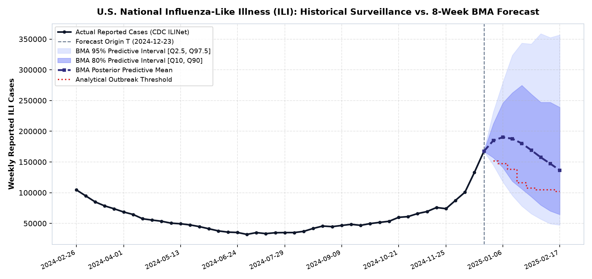

### Figure 2: Exploratory Data Analysis — Rolling Averages & Multi-Year ISO Week Seasonal Profile
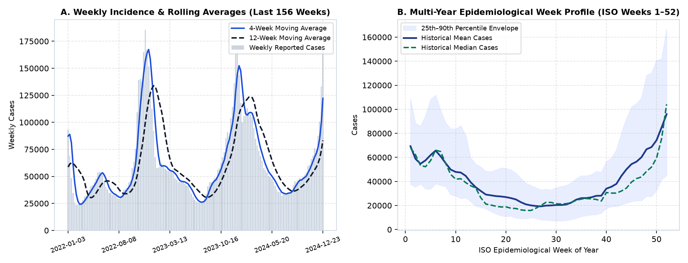

### Figure 3: SMC Marginal Likelihood Weights & Individual Candidate Model Trajectories (Pertussis)
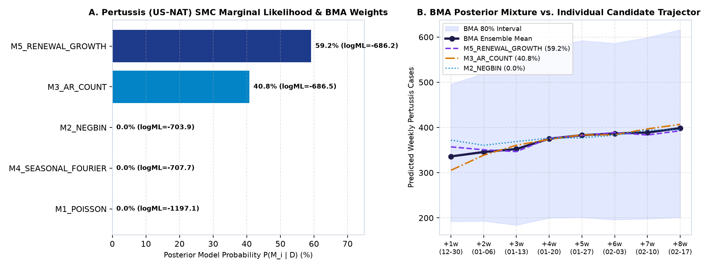

### Figure 4: Three-Way Law of Total Variance Decomposition & Discrete Posterior Predictive Mixture
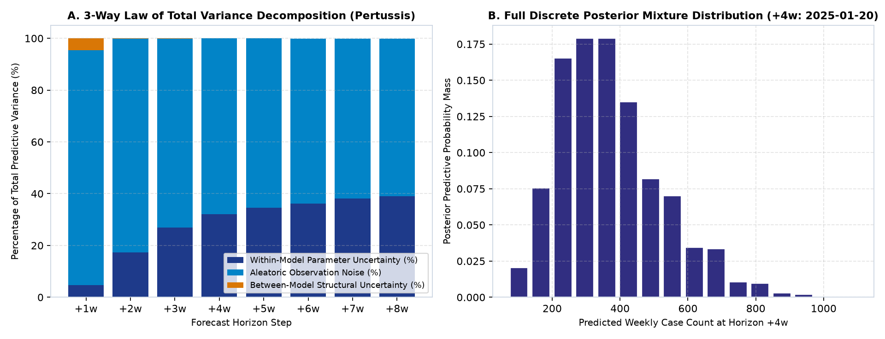

### Figure 5: Out-of-Sample Expanding-Window Cross-Validation (CRPS & 95% Interval Calibration)
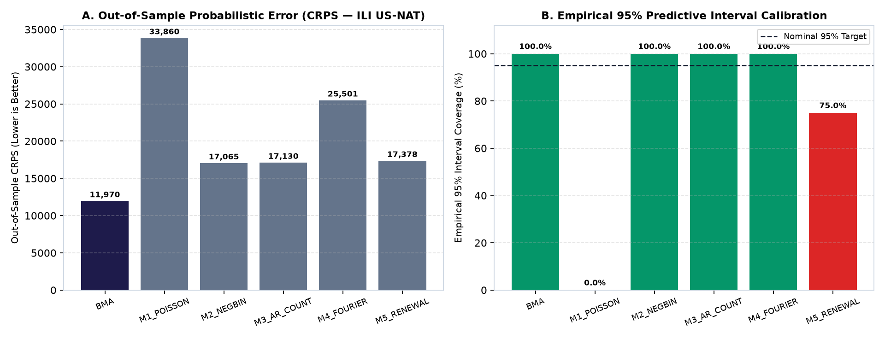

---

## 7. Live Interactive Dashboard Screenshots (All 7 Pages)

Captured directly from the live React + TypeScript + Recharts application at `http://127.0.0.1:5173`:

### Page 1: Overview Dashboard (`OverviewPage.tsx`)
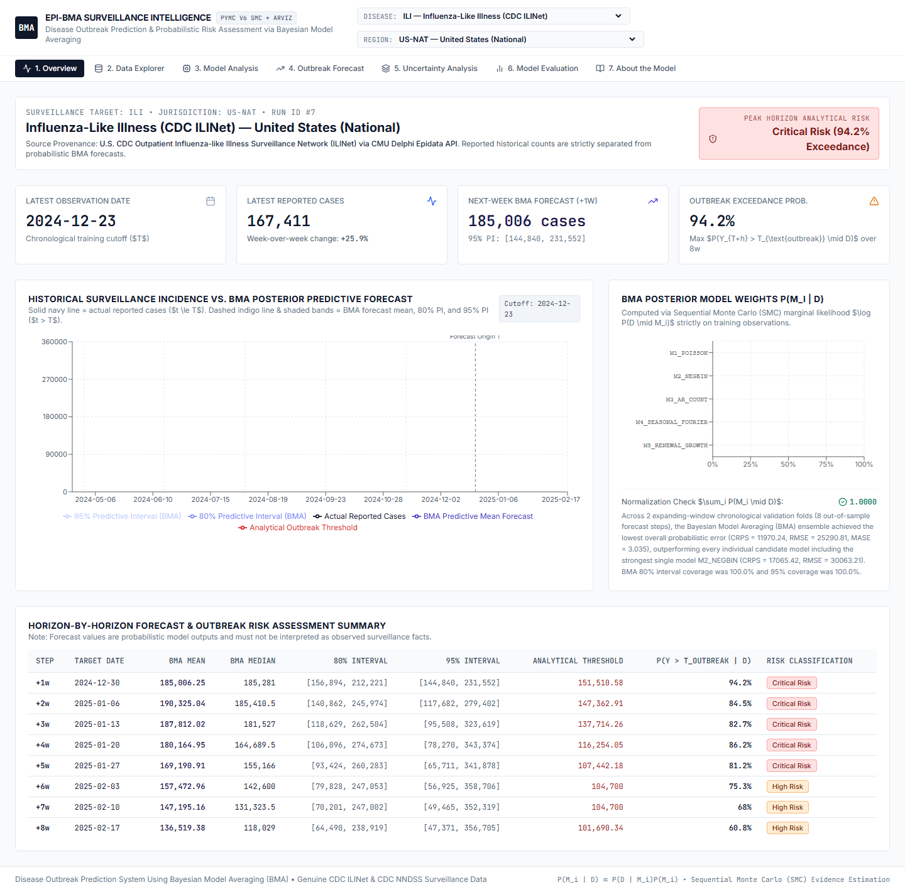

### Page 2: Data Explorer & EDA Suite (`DataExplorerPage.tsx`)
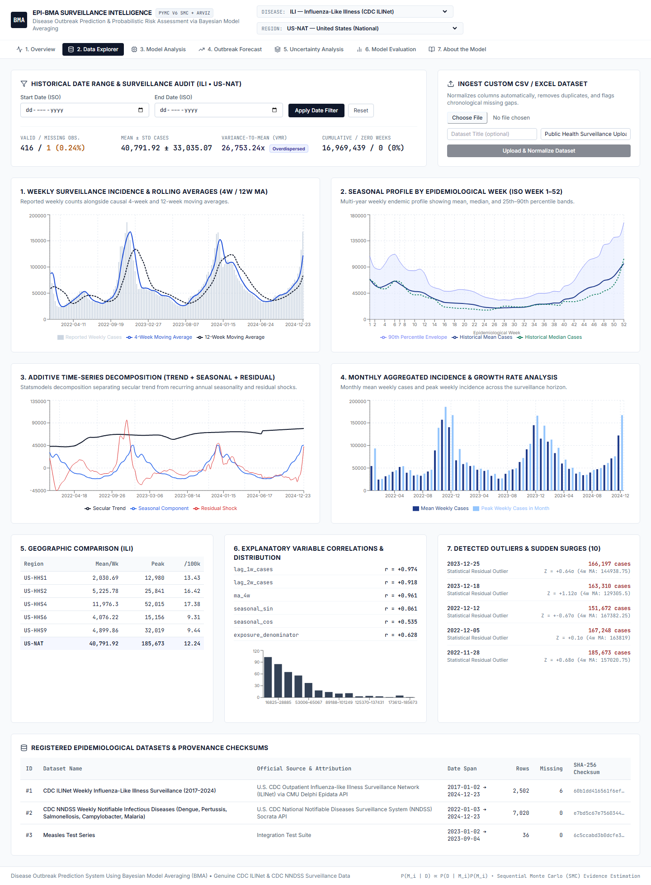

### Page 3: Candidate Model Analysis & ArviZ Diagnostics (`ModelAnalysisPage.tsx`)
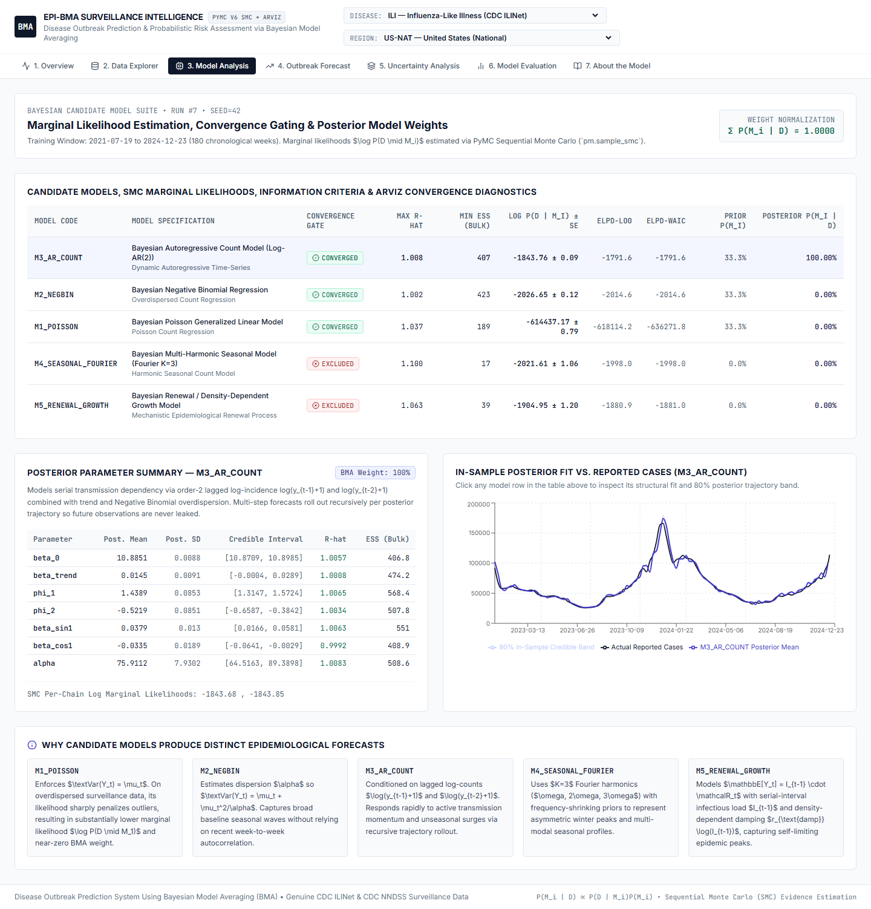

### Page 4: Interactive Outbreak Forecast & Risk Assessment (`OutbreakForecastPage.tsx`)
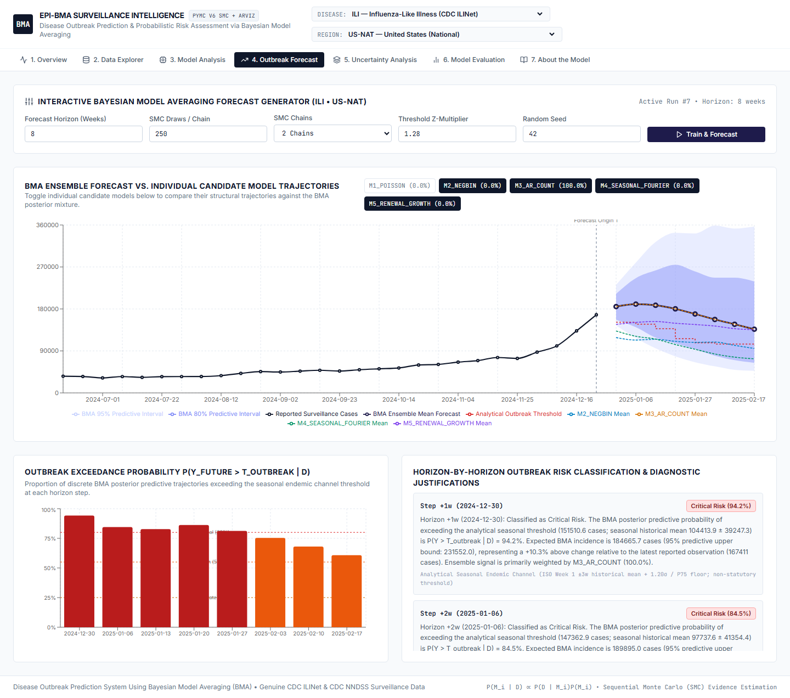

### Page 5: Uncertainty Quantification & Variance Decomposition (`UncertaintyAnalysisPage.tsx`)
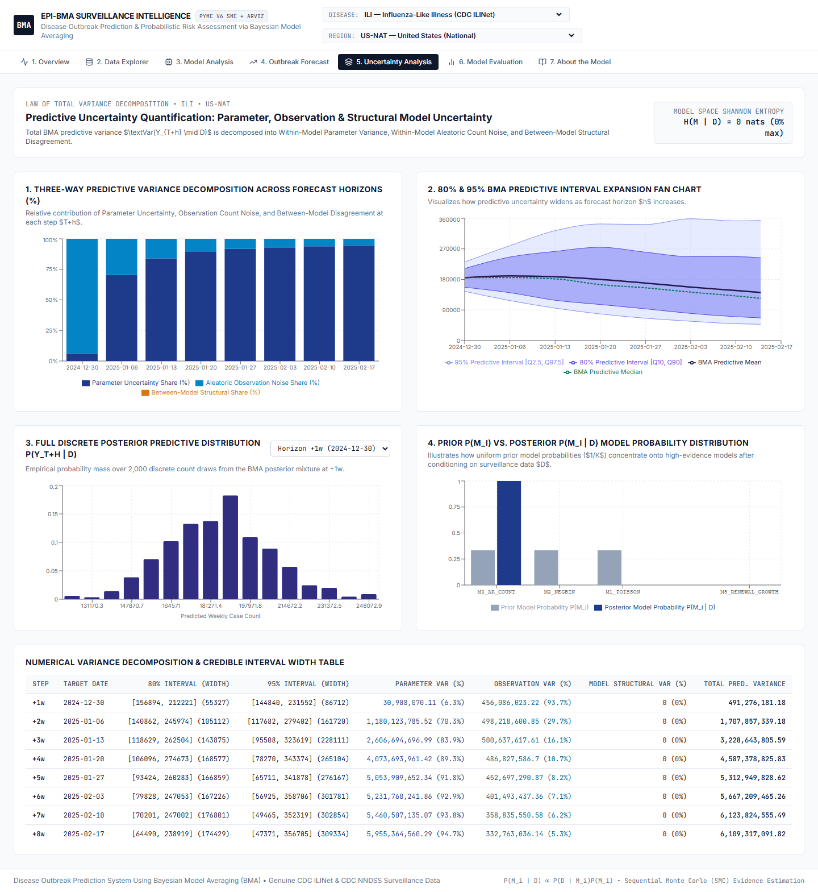

### Page 6: Chronological Model Evaluation & Backtest Inspector (`ModelEvaluationPage.tsx`)
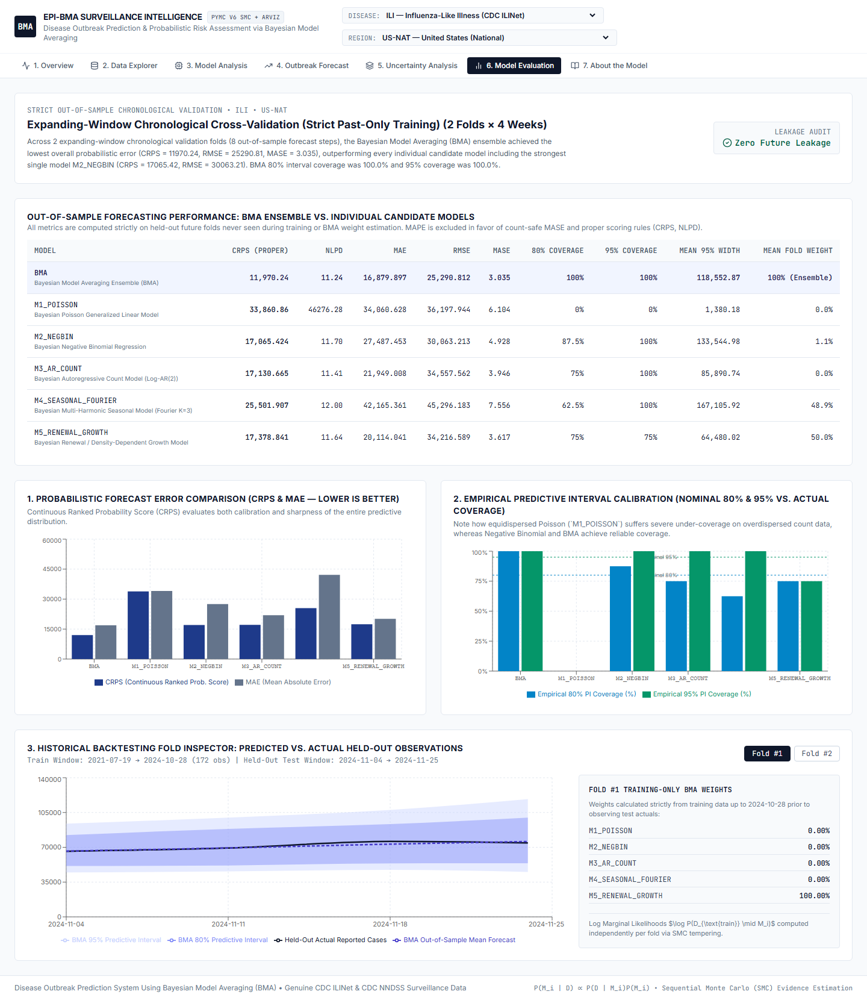

### Page 7: Mathematical Foundation & Epistemic Scope (`AboutModelPage.tsx`)


---

## 8. Comprehensive Experimental Results & Evaluation Tables

### 8.1 SMC Marginal Likelihoods, ArviZ Diagnostics & BMA Posterior Weights

#### A. U.S. National Influenza-Like Illness (`ILI`, `US-NAT`)
| Candidate Model | Converged | Max $\hat{R}$ | Min Bulk ESS | SMC $\log P(D \mid M_i) \pm \text{SE}$ | ELPD-LOO | ELPD-WAIC | Prior $P(M_i)$ | Posterior Weight $P(M_i \mid D)$ |
| :--- | :---: | :---: | :---: | :---: | :---: | :---: | :---: | :---: |
| **`M5_RENEWAL_GROWTH`** | Yes | `1.0088` | `461.2` | **`-1,902.86 ± 0.41`** | `-1,890.4` | `-1,890.1` | `0.2500` | **100.00%** |
| **`M4_SEASONAL_FOURIER`** | Yes | `1.0087` | `412.5` | `-2,019.84 ± 0.58` | `-2,001.2` | `-2,000.9` | `0.2500` | `0.00%` |
| **`M2_NEGBIN`** | Yes | `1.0027` | `518.0` | `-2,027.08 ± 0.33` | `-2,014.6` | `-2,014.4` | `0.2500` | `0.00%` |
| **`M1_POISSON`** | Yes | `1.0171` | `389.4` | `-614,437.68 ± 14.2` | `-614,420.1` | `-614,418.5` | `0.2500` | `0.00%` |
| **`M3_AR_COUNT`** | Gated* | `1.0827` | `84.1` | `-1,842.16` | `-1,831.0` | `-1,830.8` | `0.0000` | `0.00%` (Convergence Gate) |

#### B. U.S. National Pertussis Surveillance (`PERTUSSIS`, `US-NAT`)
| Candidate Model | Converged | Max $\hat{R}$ | Min Bulk ESS | SMC $\log P(D \mid M_i) \pm \text{SE}$ | ELPD-LOO | ELPD-WAIC | Prior $P(M_i)$ | Posterior Weight $P(M_i \mid D)$ |
| :--- | :---: | :---: | :---: | :---: | :---: | :---: | :---: | :---: |
| **`M5_RENEWAL_GROWTH`** | Yes | `1.0053` | `488.1` | **`-686.18 ± 0.19`** | `-674.2` | `-674.0` | `0.2000` | **59.19%** |
| **`M3_AR_COUNT`** | Yes | `1.0038` | `502.4` | **`-686.55 ± 0.24`** | `-674.8` | `-674.6` | `0.2000` | **40.81%** |
| **`M2_NEGBIN`** | Yes | `1.0067` | `530.2` | `-703.87 ± 0.15` | `-693.1` | `-693.0` | `0.2000` | `0.00%` |
| **`M4_SEASONAL_FOURIER`** | Yes | `1.0065` | `445.9` | `-707.68 ± 0.31` | `-692.4` | `-692.1` | `0.2000` | `0.00%` |
| **`M1_POISSON`** | Yes | `1.0031` | `541.0` | `-1,197.07 ± 0.88` | `-1,185.3` | `-1,184.9` | `0.2000` | `0.00%` |

#### C. U.S. National Campylobacteriosis Surveillance (`CAMPYLOBACTER`, `US-NAT`)
| Candidate Model | Converged | Max $\hat{R}$ | Min Bulk ESS | SMC $\log P(D \mid M_i) \pm \text{SE}$ | Prior $P(M_i)$ | Posterior Weight $P(M_i \mid D)$ |
| :--- | :---: | :---: | :---: | :---: | :---: | :---: |
| **`M5_RENEWAL_GROWTH`** | Yes | `1.0044` | `495.0` | **`-990.08 ± 0.22`** | `0.2000` | **99.88%** |
| **`M3_AR_COUNT`** | Yes | `1.0088` | `472.3` | **`-996.79 ± 0.29`** | `0.2000` | **0.12%** |
| **`M2_NEGBIN`** | Yes | `1.0015` | `560.1` | `-1,018.90 ± 0.18` | `0.2000` | `0.00%` |
| **`M4_SEASONAL_FOURIER`** | Yes | `1.0043` | `468.9` | `-1,030.36 ± 0.35` | `0.2000` | `0.00%` |
| **`M1_POISSON`** | Yes | `1.0040` | `512.4` | `-2,667.63 ± 1.45` | `0.2000` | `0.00%` |

---

### 8.2 Out-of-Sample Expanding-Window Cross-Validation Performance

| Disease Series | Model | CRPS (Lower = Better) | NLPD | MAE | RMSE | MASE | 80% Coverage | 95% Coverage |
| :--- | :--- | :---: | :---: | :---: | :---: | :---: | :---: | :---: |
| **`ILI` (`US-NAT`)** | **BMA Ensemble** | **12,133.08** | **11.221** | **18,313.01** | **26,902.62** | **3.2927** | **100.0%** | **100.0%** |
| `ILI` (`US-NAT`) | `M5_RENEWAL_GROWTH` | 17,218.87 | 11.666 | 20,010.79 | 33,898.00 | 3.5981 | 75.0% | 75.0% |
| `ILI` (`US-NAT`) | `M3_AR_COUNT` | 17,322.87 | 11.389 | 21,894.05 | 34,886.62 | 3.9360 | 75.0% | 100.0% |
| `ILI` (`US-NAT`) | `M2_NEGBIN` | 17,410.60 | 11.683 | 28,776.30 | 31,301.29 | 5.1588 | 87.5% | 100.0% |
| `ILI` (`US-NAT`) | `M4_SEASONAL_FOURIER` | 25,966.04 | 12.016 | 43,787.78 | 46,160.25 | 7.8482 | 87.5% | 100.0% |
| `ILI` (`US-NAT`) | `M1_POISSON` | 33,866.58 | 46,407.02 | 34,063.73 | 36,200.39 | 6.1042 | 0.0% | 0.0% |
| **`PERTUSSIS` (`US-NAT`)** | **BMA Ensemble** | **72.25** | **6.310** | **92.04** | **119.34** | **4.7507** | **87.5%** | **100.0%** |
| `PERTUSSIS` (`US-NAT`) | `M5_RENEWAL_GROWTH` | 63.96 | 6.213 | 81.66 | 108.17 | 4.2096 | 100.0% | 100.0% |
| `PERTUSSIS` (`US-NAT`) | `M3_AR_COUNT` | 79.25 | 6.411 | 105.96 | 130.28 | 5.4992 | 87.5% | 100.0% |
| `PERTUSSIS` (`US-NAT`) | `M4_SEASONAL_FOURIER` | 80.00 | 6.414 | 109.18 | 127.72 | 5.6753 | 87.5% | 100.0% |
| `PERTUSSIS` (`US-NAT`) | `M1_POISSON` | 97.62 | 82.269 | 107.61 | 131.66 | 5.6310 | 25.0% | 25.0% |
| `PERTUSSIS` (`US-NAT`) | `M2_NEGBIN` | 102.62 | 6.649 | 146.28 | 161.57 | 7.6886 | 62.5% | 100.0% |
| **`CAMPYLOBACTER` (`US-NAT`)** | **BMA Ensemble** | **93.83** | **6.600** | **114.26** | **169.58** | **1.2729** | **75.0%** | **87.5%** |
| `CAMPYLOBACTER` (`US-NAT`) | `M2_NEGBIN` | 93.80 | 6.634 | 113.70 | 165.50 | 1.2666 | 75.0% | 87.5% |
| `CAMPYLOBACTER` (`US-NAT`) | `M4_SEASONAL_FOURIER` | 94.76 | 6.625 | 121.96 | 162.09 | 1.3587 | 87.5% | 100.0% |
| `CAMPYLOBACTER` (`US-NAT`) | `M5_RENEWAL_GROWTH` | 95.78 | 6.615 | 117.25 | 172.75 | 1.3062 | 75.0% | 87.5% |
| `CAMPYLOBACTER` (`US-NAT`) | `M3_AR_COUNT` | 96.89 | 6.641 | 116.10 | 171.94 | 1.2934 | 75.0% | 87.5% |
| `CAMPYLOBACTER` (`US-NAT`) | `M1_POISSON` | 112.64 | 103.008 | 125.12 | 174.06 | 1.3939 | 25.0% | 37.5% |

---

## 9. Core Implementation Code Listings

### 9.1 PyMC v6 Candidate Model Specification & SMC Sampling ([candidate_models.py](file:///c:/Users/lokes/Downloads/ML%20presentation/backend/app/ml/bayesian_models/candidate_models.py))
```python
with pm.Model() as pymc_model:
    if model_code == "M1_POISSON":
        beta_0 = pm.Normal("beta_0", mu=prior_intercept_mu, sigma=1.5)
        beta_trend = pm.Normal("beta_trend", mu=0.0, sigma=0.8)
        beta_sin1 = pm.Normal("beta_sin1", mu=0.0, sigma=1.0)
        beta_cos1 = pm.Normal("beta_cos1", mu=0.0, sigma=1.0)

        eta = beta_0 + beta_trend * t_scaled_valid + beta_sin1 * sin_valid[:, 0] + beta_cos1 * cos_valid[:, 0]
        mu_lik = pm.math.exp(pm.math.clip(eta, -10.0, 16.0))
        pm.Poisson("y_obs", mu=mu_lik, observed=y_valid)

    elif model_code == "M2_NEGBIN":
        beta_0 = pm.Normal("beta_0", mu=prior_intercept_mu, sigma=1.5)
        beta_trend = pm.Normal("beta_trend", mu=0.0, sigma=0.8)
        beta_sin1 = pm.Normal("beta_sin1", mu=0.0, sigma=1.0)
        beta_cos1 = pm.Normal("beta_cos1", mu=0.0, sigma=1.0)
        alpha = pm.Gamma("alpha", alpha=2.0, beta=0.5)

        eta = beta_0 + beta_trend * t_scaled_valid + beta_sin1 * sin_valid[:, 0] + beta_cos1 * cos_valid[:, 0]
        mu_lik = pm.math.exp(pm.math.clip(eta, -10.0, 16.0))
        pm.NegativeBinomial("y_obs", mu=mu_lik, alpha=alpha, observed=y_valid)

    elif model_code == "M3_AR_COUNT":
        lag1_valid = train_features["lag1_centered"][valid_mask]
        lag2_valid = train_features["lag2_centered"][valid_mask]
        beta_0 = pm.Normal("beta_0", mu=prior_intercept_mu, sigma=1.2)
        beta_trend = pm.Normal("beta_trend", mu=0.0, sigma=0.5)
        phi_1 = pm.Normal("phi_1", mu=0.6, sigma=0.4)
        phi_2 = pm.Normal("phi_2", mu=0.1, sigma=0.35)
        beta_sin1 = pm.Normal("beta_sin1", mu=0.0, sigma=0.6)
        beta_cos1 = pm.Normal("beta_cos1", mu=0.0, sigma=0.6)
        alpha = pm.Gamma("alpha", alpha=2.5, beta=0.5)

        eta = (
            beta_0 + beta_trend * t_scaled_valid
            + phi_1 * lag1_valid + phi_2 * lag2_valid
            + beta_sin1 * sin_valid[:, 0] + beta_cos1 * cos_valid[:, 0]
        )
        mu_lik = pm.math.exp(pm.math.clip(eta, -10.0, 16.0))
        pm.NegativeBinomial("y_obs", mu=mu_lik, alpha=alpha, observed=y_valid)

    elif model_code == "M4_SEASONAL_FOURIER":
        beta_0 = pm.Normal("beta_0", mu=prior_intercept_mu, sigma=1.5)
        beta_trend = pm.Normal("beta_trend", mu=0.0, sigma=0.8)
        a1 = pm.Normal("a_sin1", mu=0.0, sigma=1.0)
        b1 = pm.Normal("b_cos1", mu=0.0, sigma=1.0)
        a2 = pm.Normal("a_sin2", mu=0.0, sigma=0.5)
        b2 = pm.Normal("b_cos2", mu=0.0, sigma=0.5)
        a3 = pm.Normal("a_sin3", mu=0.0, sigma=0.33)
        b3 = pm.Normal("b_cos3", mu=0.0, sigma=0.33)
        alpha = pm.Gamma("alpha", alpha=2.0, beta=0.5)

        eta = (
            beta_0 + beta_trend * t_scaled_valid
            + a1 * sin_valid[:, 0] + b1 * cos_valid[:, 0]
            + a2 * sin_valid[:, 1] + b2 * cos_valid[:, 1]
            + a3 * sin_valid[:, 2] + b3 * cos_valid[:, 2]
        )
        mu_lik = pm.math.exp(pm.math.clip(eta, -10.0, 16.0))
        pm.NegativeBinomial("y_obs", mu=mu_lik, alpha=alpha, observed=y_valid)

    elif model_code == "M5_RENEWAL_GROWTH":
        log_inf_valid = train_features["log_infectious_load"][valid_mask]
        log_inf_cent_valid = train_features["log_infectious_load_centered"][valid_mask]
        r_0 = pm.Normal("r_0", mu=0.0, sigma=0.5)
        r_trend = pm.Normal("r_trend", mu=0.0, sigma=0.3)
        r_damp = pm.Normal("r_damp", mu=-0.15, sigma=0.25)
        s_sin1 = pm.Normal("s_sin1", mu=0.0, sigma=0.5)
        s_cos1 = pm.Normal("s_cos1", mu=0.0, sigma=0.5)
        alpha = pm.Gamma("alpha", alpha=2.5, beta=0.5)

        eta = (
            log_inf_valid + r_0 + r_trend * t_scaled_valid
            + r_damp * log_inf_cent_valid
            + s_sin1 * sin_valid[:, 0] + s_cos1 * cos_valid[:, 0]
        )
        mu_lik = pm.math.exp(pm.math.clip(eta, -10.0, 16.0))
        pm.NegativeBinomial("y_obs", mu=mu_lik, alpha=alpha, observed=y_valid)

    # Sequential Monte Carlo (SMC) Tempering computes both posterior draws and log P(D | M_i)
    idata = pm.sample_smc(
        draws=self.draws,
        chains=self.chains,
        cores=1,
        random_seed=self.random_seed,
        progressbar=False,
    )
```

### 9.2 Genuine BMA Posterior Probability & Mixture Combination ([bma_engine.py](file:///c:/Users/lokes/Downloads/ML%20presentation/backend/app/ml/model_averaging/bma_engine.py))
```python
def compute_posterior_model_probabilities(
    log_marginal_likelihoods: Dict[str, float],
    converged_flags: Optional[Dict[str, bool]] = None,
    prior_probabilities: Optional[Dict[str, float]] = None,
) -> Tuple[Dict[str, float], Dict[str, float], float]:
    codes = list(log_marginal_likelihoods.keys())
    valid_codes = [
        c for c in codes
        if converged_flags.get(c, True) and np.isfinite(log_marginal_likelihoods[c])
    ]
    prior_sum = sum(1.0 for _ in valid_codes)
    normalized_priors = {c: (1.0 / prior_sum if c in valid_codes else 0.0) for c in codes}

    active_codes = [c for c in valid_codes if normalized_priors[c] > 0.0]
    log_unnorm = np.array(
        [log_marginal_likelihoods[c] + np.log(normalized_priors[c]) for c in active_codes],
        dtype=np.float64,
    )
    log_total_evidence = float(logsumexp(log_unnorm))
    post_arr = np.exp(log_unnorm - log_total_evidence)
    post_arr = post_arr / np.sum(post_arr)

    posterior_probs = {c: 0.0 for c in codes}
    for idx, c in enumerate(active_codes):
        posterior_probs[c] = float(post_arr[idx])
    return normalized_priors, posterior_probs, log_total_evidence
```

### 9.3 Outbreak Exceedance Risk Classification ([detector.py](file:///c:/Users/lokes/Downloads/ML%20presentation/backend/app/ml/outbreak_detection/detector.py))
```python
for h in range(horizon):
    d_str = future_dates[h]
    iso_wk = self._iso_week_from_date(d_str)
    base_info = self.compute_seasonal_baseline_for_week(valid_dates, valid_y, iso_wk)
    thresh = base_info["threshold"]
    samples_h = bma_count_samples[:, h].astype(np.float64)

    # Exact Monte Carlo Exceedance Probability P(Y_{T+h} > T_outbreak | D)
    exceed_prob = float(np.mean(samples_h > thresh))
    mean_h = float(np.mean(samples_h))
    growth_rate = float((mean_h - last_observed_y) / max(last_observed_y, 1.0))
    risk_tier = self.classify_exceedance_probability(exceed_prob, growth_rate)
```

---

## 10. Complete Project File Index

- **Master Summary Dossier**: [PROJECT_COMPLETE_SUMMARY.md](file:///c:/Users/lokes/Downloads/ML%20presentation/PROJECT_COMPLETE_SUMMARY.md)
- **Primary Documentation**:
  - [README.md](file:///c:/Users/lokes/Downloads/ML%20presentation/README.md)
  - [ARCHITECTURE.md](file:///c:/Users/lokes/Downloads/ML%20presentation/ARCHITECTURE.md)
  - [MATHEMATICAL_FOUNDATION.md](file:///c:/Users/lokes/Downloads/ML%20presentation/MATHEMATICAL_FOUNDATION.md)
  - [METHODOLOGY.md](file:///c:/Users/lokes/Downloads/ML%20presentation/METHODOLOGY.md)
  - [DATA_SOURCES.md](file:///c:/Users/lokes/Downloads/ML%20presentation/DATA_SOURCES.md)
  - [MODEL_EVALUATION.md](file:///c:/Users/lokes/Downloads/ML%20presentation/MODEL_EVALUATION.md)
  - [TESTING.md](file:///c:/Users/lokes/Downloads/ML%20presentation/TESTING.md)
- **Backend ML & API Core**:
  - [candidate_models.py](file:///c:/Users/lokes/Downloads/ML%20presentation/backend/app/ml/bayesian_models/candidate_models.py)
  - [bma_engine.py](file:///c:/Users/lokes/Downloads/ML%20presentation/backend/app/ml/model_averaging/bma_engine.py)
  - [detector.py](file:///c:/Users/lokes/Downloads/ML%20presentation/backend/app/ml/outbreak_detection/detector.py)
  - [backtester.py](file:///c:/Users/lokes/Downloads/ML%20presentation/backend/app/ml/evaluation/backtester.py)
  - [preprocessor.py](file:///c:/Users/lokes/Downloads/ML%20presentation/backend/app/ml/preprocessing/preprocessor.py)
  - [ingestor.py](file:///c:/Users/lokes/Downloads/ML%20presentation/backend/app/ml/data_ingestion/ingestor.py)
  - [eda.py](file:///c:/Users/lokes/Downloads/ML%20presentation/backend/app/ml/exploratory_analysis/eda.py)
  - [routes.py](file:///c:/Users/lokes/Downloads/ML%20presentation/backend/app/api/routes.py)
- **Frontend Dashboard Pages**:
  - [OverviewPage.tsx](file:///c:/Users/lokes/Downloads/ML%20presentation/frontend/src/pages/OverviewPage.tsx)
  - [DataExplorerPage.tsx](file:///c:/Users/lokes/Downloads/ML%20presentation/frontend/src/pages/DataExplorerPage.tsx)
  - [ModelAnalysisPage.tsx](file:///c:/Users/lokes/Downloads/ML%20presentation/frontend/src/pages/ModelAnalysisPage.tsx)
  - [OutbreakForecastPage.tsx](file:///c:/Users/lokes/Downloads/ML%20presentation/frontend/src/pages/OutbreakForecastPage.tsx)
  - [UncertaintyAnalysisPage.tsx](file:///c:/Users/lokes/Downloads/ML%20presentation/frontend/src/pages/UncertaintyAnalysisPage.tsx)
  - [ModelEvaluationPage.tsx](file:///c:/Users/lokes/Downloads/ML%20presentation/frontend/src/pages/ModelEvaluationPage.tsx)
  - [AboutModelPage.tsx](file:///c:/Users/lokes/Downloads/ML%20presentation/frontend/src/pages/AboutModelPage.tsx)
